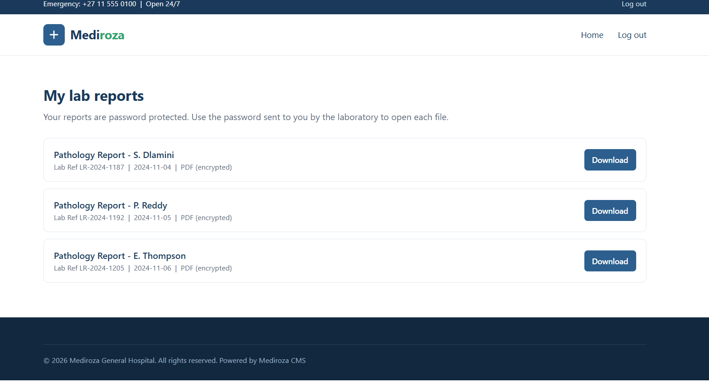
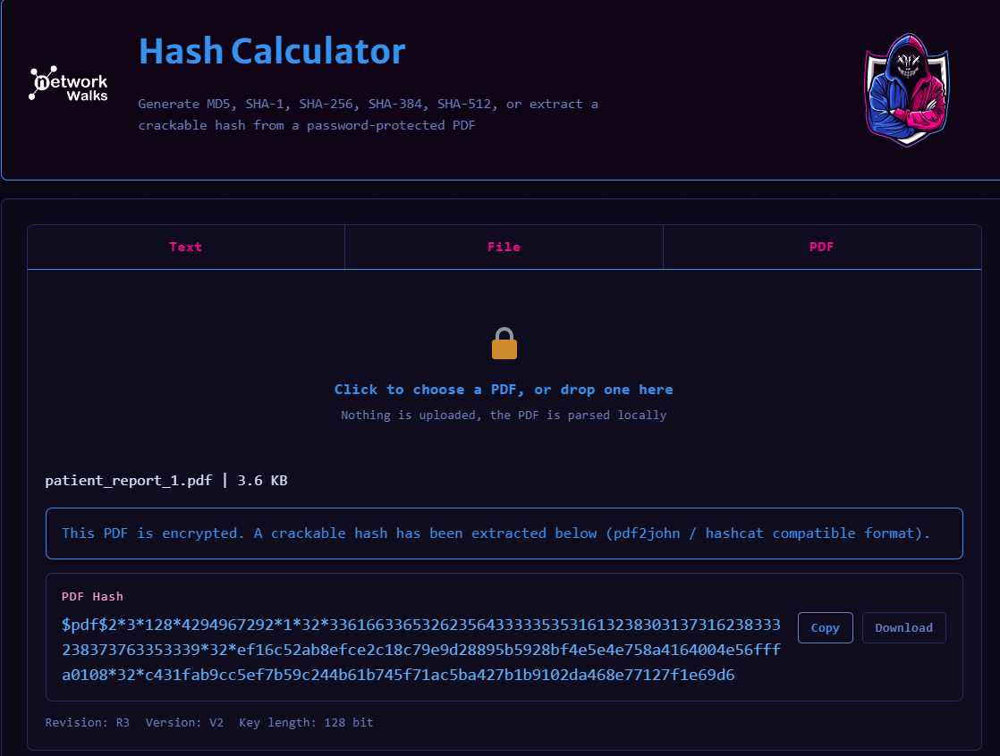
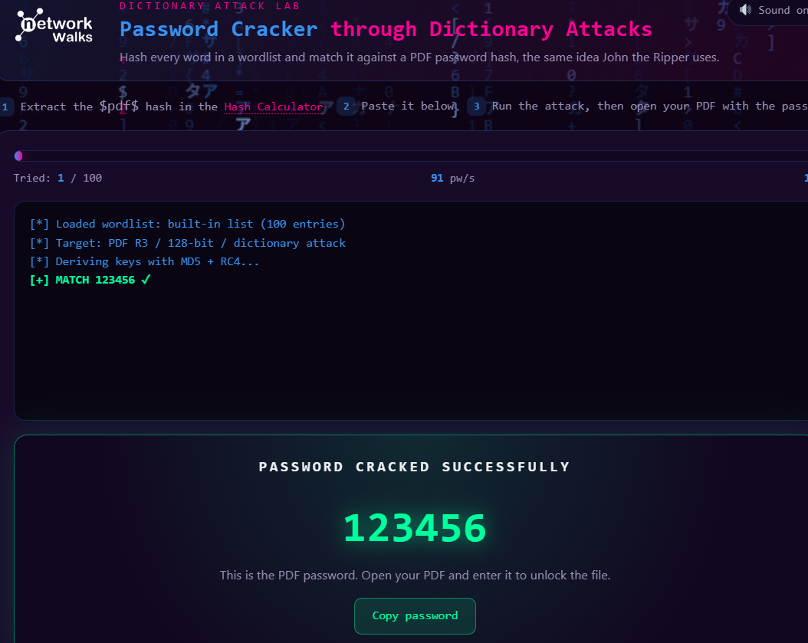
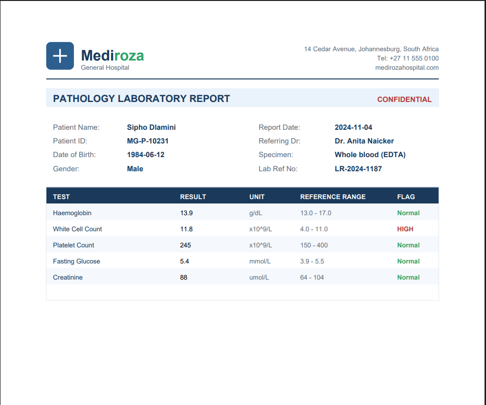
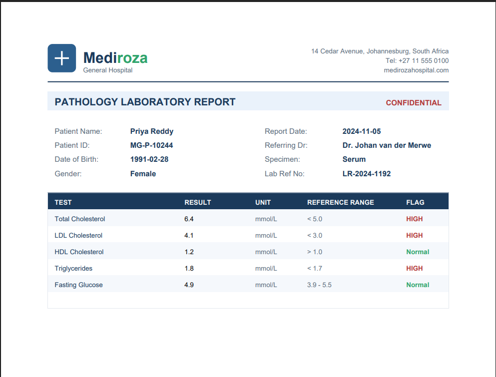
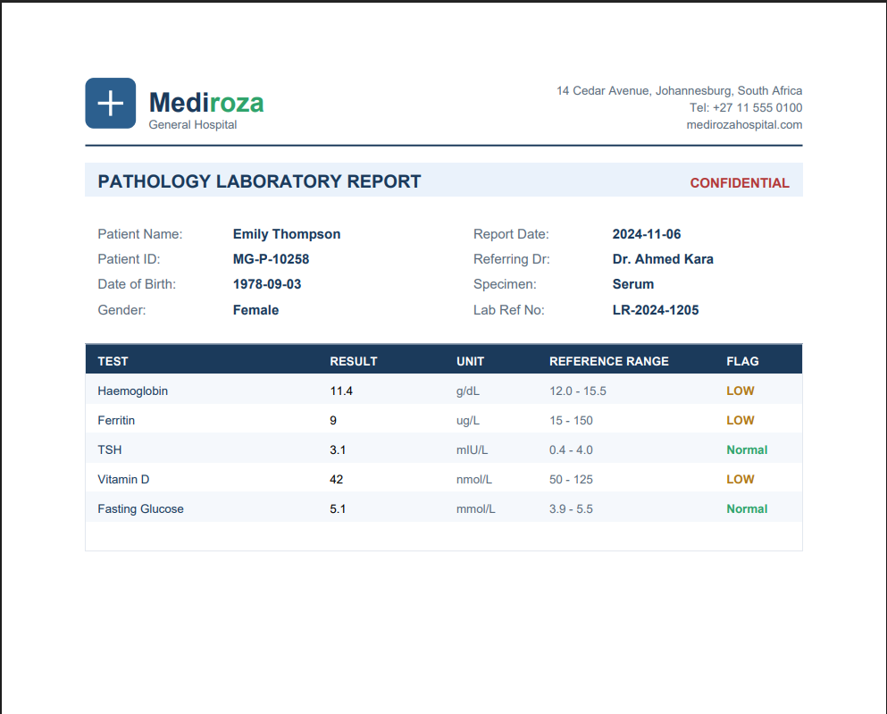
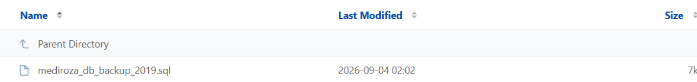

<h1 align="center">🔐 NetworkWalks B084 – Week 4 Cybersecurity Project</h1>

<h1 align="center">Mediroza Hospital</h1>
<h3 align="center">Penetration Testing &amp; Vulnerability Assessment</h3>

  
  
  

  <b>Educational Cybersecurity Practical Project</b> 
  Simulated Hospital Security Assessment

---

## 📌 Project Overview

This repository documents my Week 4 cybersecurity practical project, completed as part of the **NetworkWalks Cybersecurity Training Program – Batch B084**.

The project focuses on penetration testing and vulnerability assessment of a simulated hospital environment named **Mediroza Hospital**.

The work covers reconnaissance, patient portal security, PDF document password analysis, directory listing investigation, database backup exposure assessment, security recommendations, and professional report writing.

## 👨‍💻 Student Information

| Detail | Information |
|:---|:---|
| Student Name | Musadiq Mehmood Qureshi |
| Organization | NetworkWalks |
| Batch | B084 |
| Instructor | Waqas Karim (CCIE) |
| Project | Week 4 – Mediroza Hospital |
| Environment | Kali Linux |
| Project Type | Educational Cybersecurity Exercise |
| Overall Risk Assessment | **Critical** |

## 🎯 Project Objectives

- Perform reconnaissance and information gathering.
- Identify publicly exposed website information.
- Review patient portal security.
- Understand SQL injection and access-control weaknesses.
- Examine PDF document password security.
- Investigate robots.txt and directory listing.
- Identify risks associated with exposed database backups.
- Assess security findings and recommend remediation.
- Prepare a professional penetration testing report.

## 🧪 Project Milestones

### Milestone 1 – Reconnaissance and Information Gathering

- WHOIS lookup.
- Website technology identification using WhatWeb.
- DNS information gathering.
- HTTP response and header inspection.
- Web Application Firewall detection.
- Network and service scanning using Nmap.
- robots.txt inspection.

### Milestone 2 – Patient Portal and PDF Document Security

- Patient portal security review.
- SQL injection observations.
- Authentication and access-control weaknesses.
- PDF hash analysis.
- Password recovery testing on supplied training documents.

### Milestone 3 – Directory Listing and Exposed Database Backup

- Investigation of the `/old/` directory.
- Directory listing exposure.
- Discovery of a legacy SQL database backup.
- Review of reported staff and shareholder data exposure.
- Security impact assessment.

### Milestone 4 – Penetration Testing Report Writing

- Organizing project findings and evidence.
- Assessing vulnerability risk levels.
- Preparing security recommendations.
- Arranging project screenshots.
- Writing and formatting the final report.
- Exporting the completed report as PDF.

## 🛠️ Tools and Technologies

  
  
  
  
  

- WHOIS
- WhatWeb
- Nslookup
- cURL
- WAFW00F
- DNSRecon
- Nmap
- Burp Suite
- Wireshark
- Python 3
- Hash Calculator
- Password Cracker

## 🚨 Security Findings

| Security Finding | Risk Level |
|:---|:---|
| Reconnaissance Information Disclosure | Low |
| SQL Injection and Access-Control Weaknesses | Critical |
| Weak PDF Document Passwords | High |
| Exposed Legacy Database Backup | Critical |
| Missing Modern HTTP Security Headers | Low |

  

  <i>Risk ratings relate only to the reported findings in this simulated training exercise.</i>

## 📸 Project Screenshots

The following screenshots document the practical activities and evidence from the project.

### Figure 1 – Patient Portal

  

### Figure 2 – Hash Calculator

  

### Figure 3 – Password Cracker

  

### Figure 4 – PDF Report 01

  

### Figure 5 – PDF Report 02

  

### Figure 6 – PDF Report 03

  

### Figure 7 – Directory Listing and Backup File

  

## 📄 Final Penetration Testing Report

The complete Week 4 Mediroza Hospital penetration testing report is available below.

  

**Report file:** `Report/NetworkWalks_Week4_Final_Report.pdf`

## 📚 Learning Outcomes

Through this project, I gained practical knowledge of:

- Cybersecurity reconnaissance.
- Web application security assessment.
- SQL injection concepts.
- Authentication and access-control weaknesses.
- PDF password security testing.
- Directory listing and information exposure.
- Vulnerability assessment and risk analysis.
- Security recommendations and remediation.
- Professional cybersecurity report writing.

## 🙏 Acknowledgement

My sincere thanks to **Waqas Karim (CCIE)** and the **NetworkWalks team** for their guidance and support throughout this cybersecurity training program.

## ⚠️ Disclaimer

This repository documents a simulated educational cybersecurity exercise conducted as part of the NetworkWalks training program.

All hospital, patient, staff, and shareholder information mentioned in this project is simulated training data. No real hospital, patient-data breach, or security incident is being reported.

All testing activities were conducted within the designated training environment. This project is intended for educational purposes only.

## 👤 Author

**Musadiq Mehmood Qureshi**

  
  

---

  <b>NetworkWalks | Cybersecurity Training | Batch B084 | Week 4</b>

